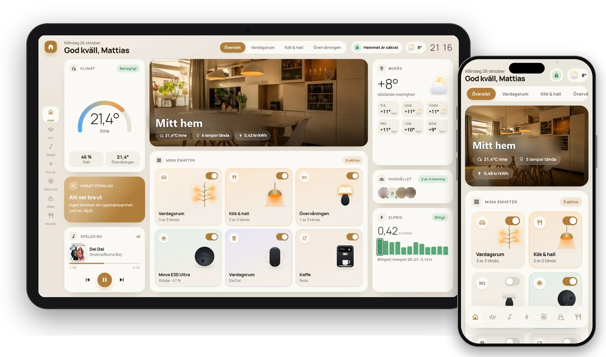
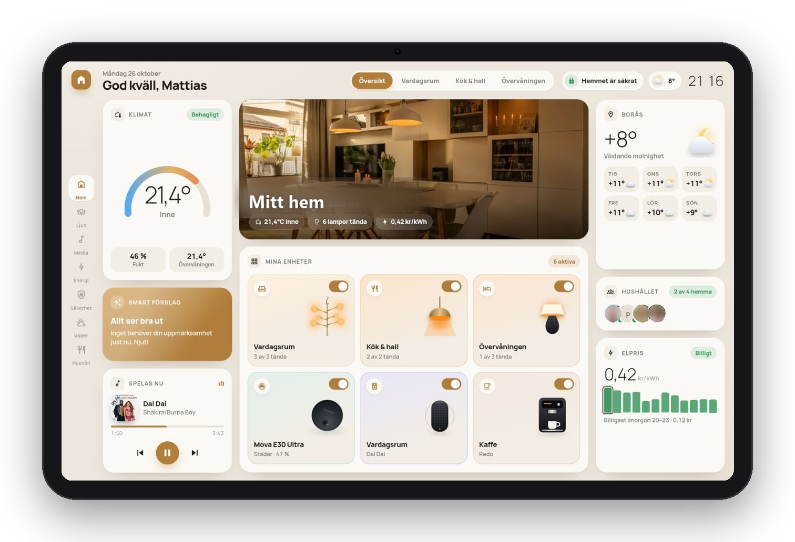
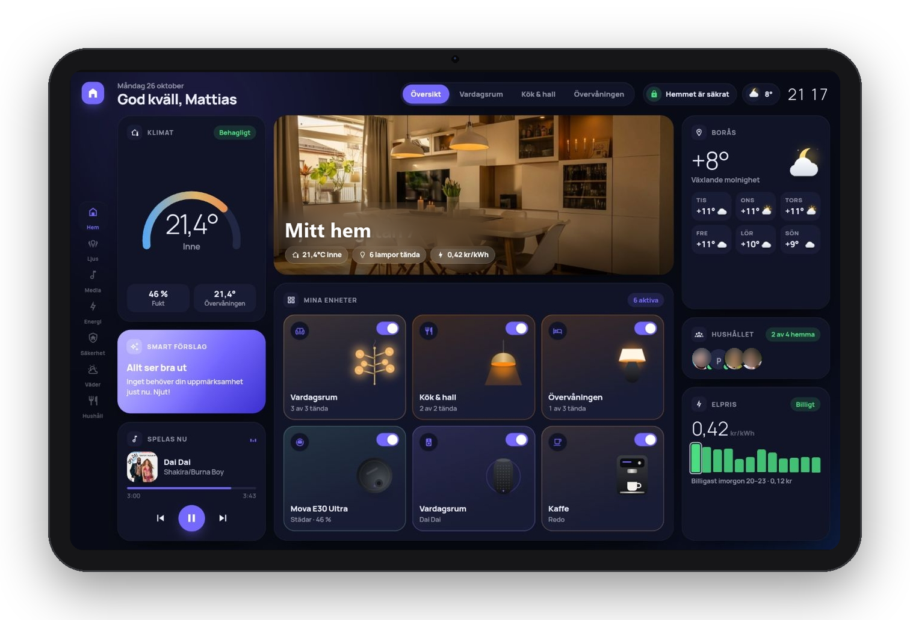
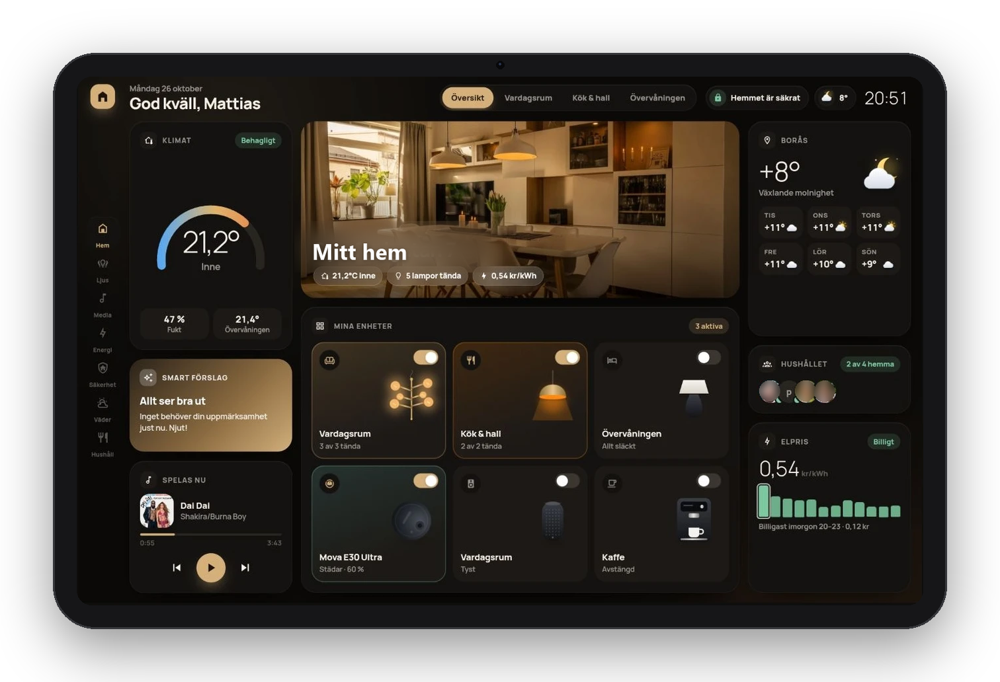
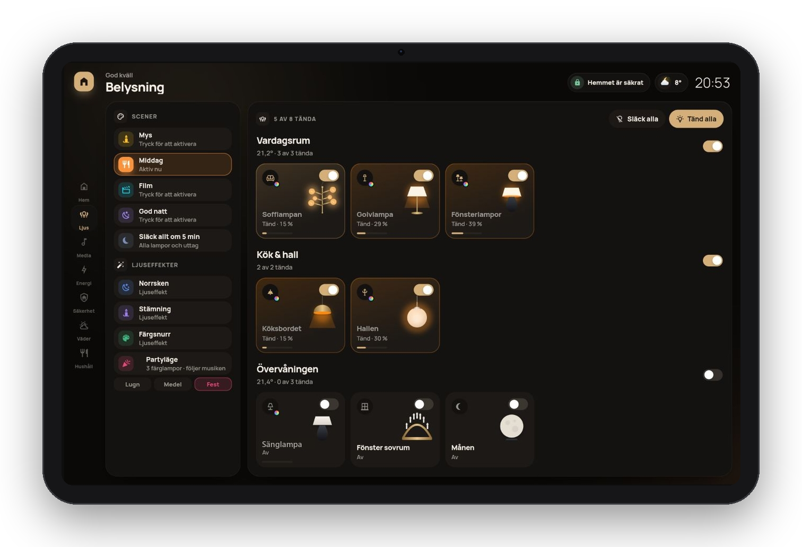
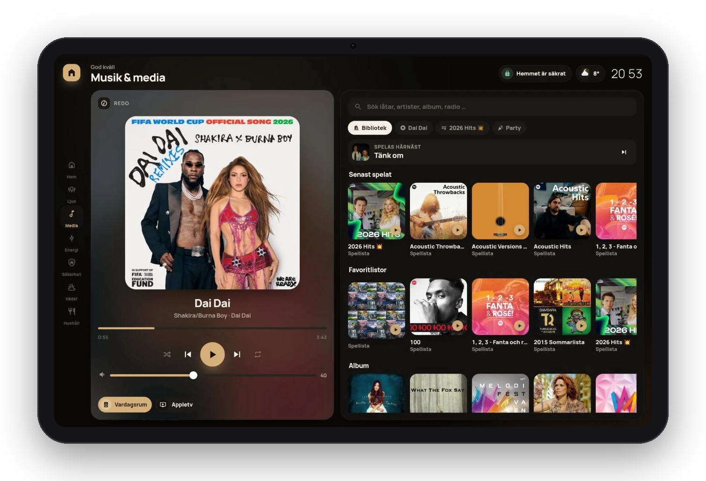
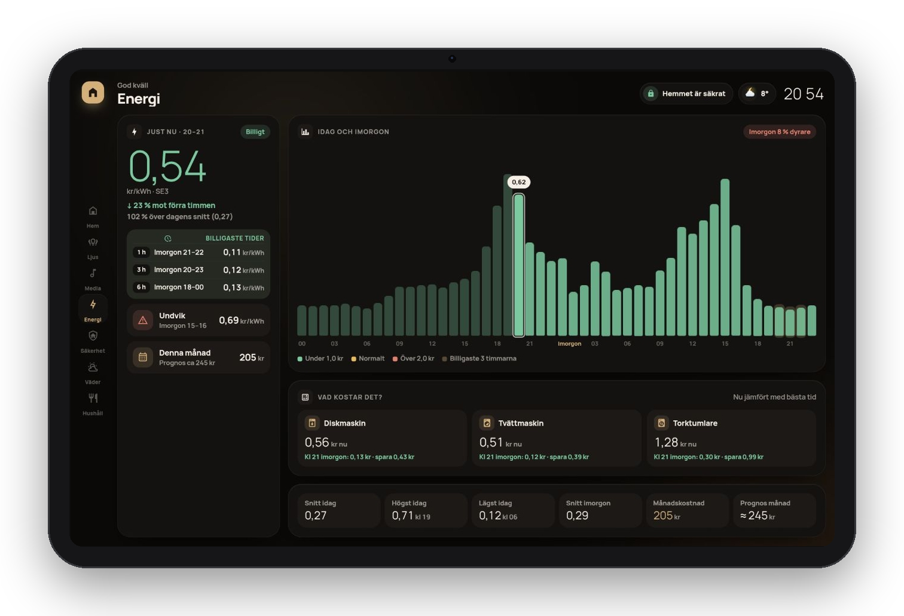
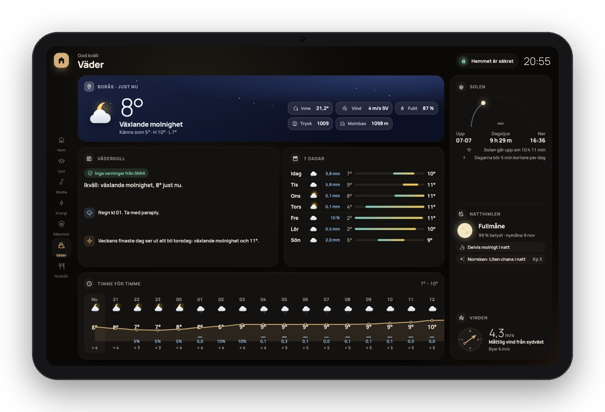
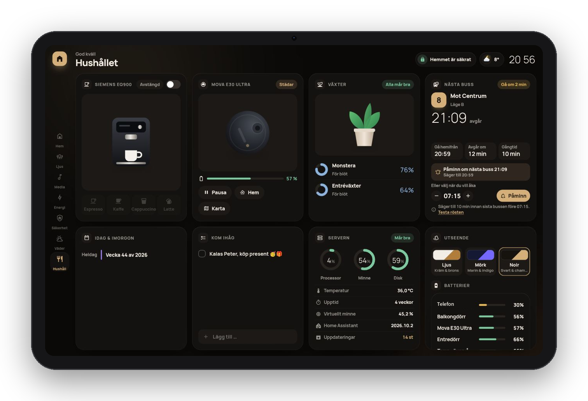
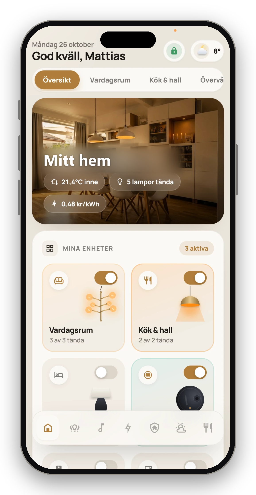

# Aura – en premium-dashboard för Home Assistant

> *A modern, animated Home Assistant dashboard in Swedish, built on a single `custom:button-card`. Fits a landscape tablet without scrolling, works great on phones, and is configured from one simple settings block.*

Aura är en komplett dashboard för Home Assistant med ett modernt, animerat utseende i stil med en köpt app. Hela gränssnittet ritas av **ett enda button-card-kort** och styrs från **ett enda inställningsblock** (`mitt_hem`). Byter du hem, lampor eller sensorer ändrar du några rader, inte hela dashboarden.

<p align="center">
  
</p>

<p align="center">
  <a href="https://www.youtube.com/shorts/4hE8C9R9Sck"></a><br>
  <a href="https://www.youtube.com/shorts/4hE8C9R9Sck"><b>▶ Se Aura i rörelse på YouTube</b></a>
</p>

---

## ✨ Höjdpunkter

- **Får plats på en surfplatta i liggande läge.** Ingen skrollning, och på mobilen staplas korten snyggt.
- **Tre teman:** *Ljus* (kräm och brons), *Mörk* (marin och indigo) och *Noir* (svart och champagne). Temat kan bytas per enhet direkt i dashboarden.
- **Ritade produktbilder** som tänds, lyser i lampans färg och rör sig: taklampa, klotlampa, takkrona, golv- och bordslampa, ljusstake, månlampa, uttag, robotdammsugare, högtalare, kaffemaskin och växt. Du kan också använda egna bilder.
- **Smarta förslag:** förslag som går att ignorera, till exempel om en dörr har stått öppen i 10 minuter, om ingen är hemma men lampor är tända, om en växt behöver vatten, när elen är billig, om SMHI varnar, eller ett förslag på kvällen om att släcka allt och stänga av tv:n med en nedräkning.
- **Svenskt fokus:** Tibber och Nordpool, SMHI, Västtrafik, pollenprognos och norrsken.

## 📱 Sidorna

| Sida | Innehåll |
|---|---|
| **Hem** | Bild för hemmet eller rummet, klimat, smart förslag, spelas nu, mina enheter, väder, hushållet och elpris |
| **Ljus** | Scener, *Släck allt om 5 min*, ljuseffekter, **Partyläge** och alla lampor per rum. Dra för att dimma, tryck på ikonen för färgpanelen |
| **Media** | Music Assistant med sök, bibliotek, album, spellistor, kö och party-QR. Apple TV och smart-tv får fjärrkontroll och appar |
| **Energi** | Elpris per timme idag och imorgon, billigaste tider (1, 3 och 6 h), *Vad kostar det?* för dina maskiner, månadsprognos, förbrukning, solceller och hembatteri |
| **Säkerhet** | Larm med egen knappsats, dörrar, fönster, lås, rörelse, larmgivare och kameror |
| **Väder** | Himmelskort som följer vädret och dygnet, *Väderkoll* med SMHI-varningar och text om regn, snö, halka, blåst och UV, timmar, dagar, sol, natthimmel med norrsken och kompass |
| **Hushåll** | Kaffemaskin (Home Connect), en eller flera robotdammsugare, växter, buss med röstpåminnelse, kalender, att göra, server (System Monitor), tema och batterier |

## 📸 Skärmbilder

**Tre teman – samma hem**

| Ljus | Mörk | Noir |
|---|---|---|
|  |  |  |

**Sidorna**

| | |
|---|---|
|  |  |
|  |  |
|  | |

**På mobilen**

<p align="center"></p>

---

## 🧩 Krav

| Krävs | Valfritt |
|---|---|
| [button-card](https://github.com/custom-cards/button-card) (HACS) | [kiosk-mode](https://github.com/NemesisRE/kiosk-mode) – döljer Home Assistants menyrad |
| Home Assistant 2024.10 eller senare | Music Assistant, Alarmo, Tibber / Tibber Prices / Nordpool, SMHI, Västtrafik, Pollenprognos, System Monitor, Home Connect, bubble-card |

Allt valfritt döljs automatiskt om det saknas. Har du till exempel inget larm syns ingen säkerhetssida.

## 🚀 Installation

1. Installera **button-card** via HACS.
2. Skapa en ny dashboard: **Inställningar → Instrumentpaneler → Lägg till → Ny instrumentpanel från början**.
3. Öppna den och välj **⋮ → Redigera → ⋮ → Raw-konfigurationsredigerare**.
4. Klistra in hela [`aura_dashboard.yaml`](aura_dashboard.yaml) och spara.
5. Ändra inställningarna i blocket `mitt_hem` högst upp, så att de passar ditt hem.

## ⚙️ Inställningar

Allt du ändrar finns i `button_card_templates → mitt_hem → variables`. Ett litet urval:

```yaml
_hem_namn: Mitt hem
_plats: Göteborg
_tema: noir                       # ljus, mork eller noir
_bakgrundsbild: /local/rum/oversikt.jpg  # ändra till egen bild på ditt hem (skapa en mapp i www/rum/valfritt namn.jpg)

_rum:
  - namn: Vardagsrum
    bild: /local/rum/vardagsrum.jpg # ändra till egen bild på ditt hem (skapa en mapp i www/rum/valfritt namn.jpg
    temp: sensor.vardagsrum_temperatur
    lampor:
      - entity: light.taklampa
        namn: Taklampan
        typ: krona                # tak, klot, krona, golv, bord, glod, stake, mane, uttag – eller /local/egen.png

_mediaspelare: [media_player.vardagsrum]
_elpris: sensor.tibber_prices
_vader: weather.hem
_larm: alarm_control_panel.alarmo
_buss: sensor.mot_centrum
```

Med `_rum: []` hämtas rummen och lamporna automatiskt från dina områden i Home Assistant.

📖 **Den fullständiga guiden**, med alla inställningar, lampbilder, ikoner och felsökning, finns i [`Aura_instruktionsbok.md`](Aura_instruktionsbok.md).

## 🧰 Extrafiler

| Fil | Vad den gör |
|---|---|
| [`larm_automation.yaml`](larm_automation.yaml) | Får Alarmo att bete sig som ett riktigt larm. Högtalaren säger till när larmet slås på, när någon kommer in och när det slås av. Om larmet går skickas notiser med **kamerabild** till telefonerna, och de låter även i tyst läge. |
| [`party_script.yaml`](party_script.yaml) | Skriptet bakom **Partyläge**. Färglamporna byter färg i vald takt, med färger hämtade från **skivomslaget** på låten som spelas, och återställs när musiken pausas. |

Båda läggs in under **Inställningar → Automationer och scener** (fliken Automationer respektive Skript) via **⋮ → Redigera i YAML**.

## 🔧 Så fungerar det

- **En motor:** hela gränssnittet är en JavaScript-motor som ligger inbäddad i `aura_app`-mallen och laddas en gång.
- **Uppdateringar:** när en entitet ändras uppdateras bara den del av sidan som påverkas. Animationer och inmatning störs därför inte.
- **Inga beroenden:** inga externa kort eller bildfiler behövs. Produktbilder och vädersymboler är ritade som SVG i koden.

## 🌐 Externa tjänster

Alla är valfria och går att stänga av:

| Funktion | Tjänst | Stäng av med |
|---|---|---|
| Norrskensprognos | NOAA SWPC (Kp-index) | `_norrsken: false` |
| Regnradar (avstängd som standard) | RainViewer och Esri | `_radar: false` |

Inga personuppgifter skickas. Radarn hämtar kartbitar för området runt hemmet, inte en exakt adress.


## 📝 Licens

MIT. Använd, ändra och dela fritt.

<!-- Byt licens om du vill. Lägg i så fall en LICENSE-fil i repot. -->

## 🙏 Tack

Bygger på [button-card](https://github.com/custom-cards/button-card) av @RomRider och ikonerna från [Material Design Icons](https://pictogrammers.com/library/mdi/).
